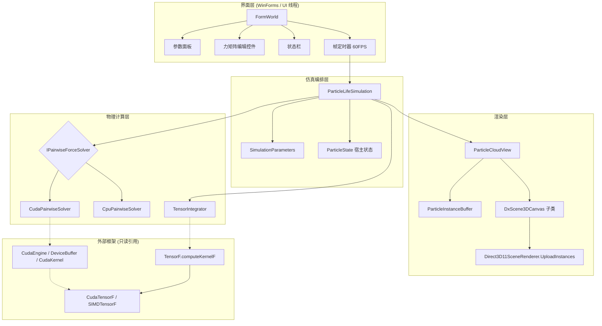

## 产品概述

在 `src\Autopoiesis\Autopoiesis.vbproj` 中实现 `algorithm\readme.md` 所描述的**二维环面非互易多体耗散动力系统（Particle Life）**：十万级粒子在 2560×1440 的环形世界中，按非对称交互矩阵相互吸引/排斥，在硬核排斥、密度抑制、线性阻尼三重作用下自发涌现出"细胞状"准稳态斑图，并以 GPU 加速实时可视化。

## 核心功能

- **每帧同步更新**：读取上一时刻完整状态快照，一次算出全部粒子的受力再统一积分，更新结果与计算顺序无关。
- **环面最小像距离**：`δ = wrap(x_i - x_j)`，`wrap(v) = v - L·round(v/L)`，跨越边界的粒子照常相互作用，力场具备平移不变性与环绕连续性。
- **非对称交互矩阵**：`F∈[-1,1]^(T×T)`，索引 `F[t_i + t_j·T]`，表示"i 被 j 吸引的程度"，`A_ij ≠ A_ji`，主动打破牛顿第三定律，是多种模式涌现的根源。
- **核密度估计（第一遍）**：`ρ_i = Σ_{j≠i,d<R}(1 - d/R)·c`，同类型 `c=1`、异类型 `c=0.5`。
- **分段线性力场（第二遍）**：密度抑制 `φ = 1 - clamp(ρ-ρ_limit, 0, 1.005)`，仅作用于吸引项 `A' = A·φ`；`d<r` 时硬核排斥 `f = 2(d/r-1)∈[-2,0)`；`r≤d≤R` 时三角形吸引核 `f = A'·(1-|d-m|/(W/2))`，峰值 `A'`，阱底在 `m=(r+R)/2`；`d>R` 时不交互；最终 `F_i = Σ_j n_ij·f·(-50)`。
- **退化与限幅**：完全重合时注入确定性 sin-hash 抖动（对称性破缺，避免永久锁死）；`|F_i|>100` 时归一化到 100。
- **阻尼辛欧拉积分**：`v ← β(v + F·Δt)`、`x ← x + v·Δt`、`x ← mod(x+L, L)`，`β=dampening` 默认 0.85，保证耗散收敛不注入能量。
- **参数实时调节**：粒子数、类型数、随机种子、粒子半径、阻尼、排斥半径、交互半径、密度上限，修改后立即生效或按需重置。
- **力矩阵编辑**：可视化 T×T 网格，格内颜色按力值绿（吸引）红（排斥）渐变，可逐格调节与归零。
- **颜色方案**：每种粒子类型可独立指定颜色，并通过颜色选择器修改。
- **交互与状态**：暂停/继续、重置（可选择性重新生成颜色与力矩阵）、全屏切换、鼠标拖拽平移与滚轮缩放、实时显示帧率/粒子数/计算后端/步数。

## 视觉与交互效果

深色科技风实时视窗：粒子以带自身类型色的屏幕对齐方形光点呈现，密集处自然堆叠出细胞状团簇，整体在近正交俯视下无缝环绕；右侧为参数滑杆与力矩阵色彩网格面板，底部为状态栏。界面在参数调整时即时响应，粒子云每帧平滑推进，缩放时可见局部细节而不会撕裂或闪烁。

## 技术栈

- 语言/工程：VB.NET，`net10.0-windows`，WinForms（`OutputType=WinExe`，`MyType=WindowsForms`，`StartupObject=Autopoiesis.My.MyApplication`），**必须 x64**（ILCuda 限制）。
- 单精度张量算子：`Microsoft.VisualBasic.MachineLearning.TensorFlow.TensorF`（`TensorFlow.vbproj`），全部算术经静态可插拔后端 `TensorF.computeKernelF : Compute.ITensorComputeF`。
- GPU 后端：`Microsoft.VisualBasic.Computing.ILCuda.GPUTensor`（`ILCudaTensor.vbproj`）的 `CudaTensorF`（`"CUDA-F32"`）；CPU 后端 `Compute.SIMDTensorF`（`"SIMD-F32"`）。
- 手写 GPU 内核：`Microsoft.VisualBasic.Computing.ILCuda`（`ILCuda.vbproj`）的 `KernelSources` + `CudaEngine` + `DeviceBuffer(Of T)` + `CudaKernel`。
- 渲染：`DxCanvas.vbproj` 的 `DxScene3DCanvas`（WinForms 控件）+ `DXApi.vbproj` 的 `Direct3D11SceneRenderer`（`UploadInstances` 实例化点云）+ `Scene`/`SceneRenderOptions`/`Camera`。
- 复用已有 `ProjectReference`，**不新增任何第三方依赖**，**不修改任何被引用工程与 algorithm/ 参考代码**。

## 实现方案

### 核心策略：两层计算分工 + 单一 CUDA 上下文

按用户确认的方案 B：**O(N²) 粒子对主循环下沉到手写 CUDA 内核**（这是唯一能支撑十万粒子实时的方法），**TensorF 承担其余张量级数学**（力限幅、阻尼辛欧拉积分、环面回绕、密度统计），并且 TensorF 的算子必须真正经过 `TensorF.computeKernelF`（可运行时在 `SIMDTensorF` 与 `CudaTensorF` 之间切换）。

关键约束与由此得出的决策：

1. `ITensorComputeF` 只暴露逐元素/`MatMul`/全局归约/CFD 原语，**没有 `Sin/Cos/Round/Floor`，也没有粒子对原语**，且每个算子都返回新张量、不支持就地写入 → 逐对力必须由自定义内核承担，张量化的 N×N 方案在显存上不可行。
2. `CudaTensorF` **没有公开的 `Engine` 属性**，而 `CudaTensorF.Register()` 会自建引擎；`CudaRuntime` 用进程级 `_default` 上下文，`CudaKernel.LaunchCore` 绑定的是该全局上下文 → **同进程建两个引擎会用错上下文**。因此装配路径固定为：先 `KernelSources.RegisterSource`/`Register`（必须在 `CudaEngine.TryCreate` 之前），再 **`CudaTensor.Register(options)`**（内部完成双/单精度内核注册 + 建唯一引擎 + 装配单精度栈），最后用公开的 `CudaTensor.Current.Engine.GetKernel("autopoiesisPairForceF32")` 取自定义内核。全程**只有一个 `CudaContext`**。
3. NVRTC 只传 `-arch=`，无 `-I`/`--std`/`--use_fast_math`/`--device-as-default-execution-space`；所有 `.cu` 被拼进**同一编译单元** → 自定义内核必须 `extern "C" __global__` 裸函数、**禁止 `#include`**、符号名全局唯一（统一加 `autopoiesis` 前缀，避免与 `ILCuda`/`ILCudaTensor` 的 `ewAddKernel`、`tensorF32*` 等撞名）。
4. `LaunchPlanner.For1D` 会把 block 数静默截断到 4096 → 内核必须写 **grid-stride 循环**才能覆盖十万粒子。
5. `CudaKernel` 参数只支持 `DeviceMemory/DeviceBuffer(Of T)`、`PinnedHostBuffer(Of Single)`、`Single`、`Double`、`Integer`、`Long`、`IntPtr`，且实参顺序必须与形参严格一致；`DeviceBuffer(Of T)` 无终结器，必须 `Using` 显式释放。
6. TensorF 无 `Floor/Round`，环面回绕 `mod(x+L, L)` 需用 `Clip(t·K, 0, 1)` 构造近似阶跃函数 `step(t)` 再重建 `floor`：因单步位移有界（`|v|Δt ≤ 约 47 ≪ L=2560`），`z=(x+L)/L ∈ (0.9996, 2.0001)`，故 `floor(z) = step(z-1) + step(z-2)` 两次求值即可，位置误差 ≤ 1e-6×L ≈ 0.003 世界单位，可忽略。

### 渲染方案（已核实可行）

- 用 `DxScene3DCanvas` + `Direct3D11SceneRenderer`：`EnsureInstanceCapacity(N)` + 每帧 `UploadInstances(Single(), N)`（每点 8 个 `Single`，与 `GpuSceneGeometry.PointInstance` 的 32 字节 stride 一致），避免每帧重建场景几何（`LoadPointCloud` 会 `Version++` 导致整块 GPU 实例缓冲重建，这正是十万点必须走外部实例云的原因）。
- **逐粒子类型色**：`SceneRenderOptions.ColorScheme` 是被硬编码为枚举 `ScalerPalette` 的，无法注入任意离散色；但已核实 `GpuSceneGeometry.PointMode = If(scene.SurfaceCount > 0, Lit, Heat)`，且 `PS_Point` 在 `PointMode=Heat` 且 `UseEmbeddedColor=True` 且 `input.color.a>0` 时**直接返回逐点嵌入色**（此时尺寸因子改从 `heat` 槽读取）。因此：场景里只放 1 个哑点使 `Scene.HasData=True`（`ExternalCloudOverlay=False` 时场景点云被外部云完全取代，哑点不会被画出），设 `UseEmbeddedColor=True`，把打包的 `R|G<<8|B<<16|A<<24` 写入第 8 个 WORD，尺寸因子 1.0 写入第 7 个 WORD。
- **精确正交俯视 2D**：`Camera` 无正交模式，投影恒为 `factor = fov/(viewDistance + Z)`。把所有粒子放在 `Z=0`，并令 `AngleX=AngleY=AngleZ=0`、**`ViewDistance=1`、`FieldOfView=zoom`（像素/世界单位）**，则 `factor ≡ zoom` 恒定，得到精确正交俯视；`Offset` 实现平移。因 `DxScene3DCanvas.OnSceneRender` 内部会先执行再渲染，相机/选项必须在 `Invalidate` 之前于 **UI 线程**写入 `canvas.Controller.Camera` 的字段与 `canvas.Options`。
- 鼠标：`DxScene3DCanvas` 的鼠标处理是 `Protected Overrides`，子类化并改写为「左键拖拽=平移 `Offset`、滚轮=缩放 `FieldOfView`（clamp 到 [0.05, 20] 像素/世界单位），与原版 zoom∈[1,10] 对应」。

### 性能与复杂度

- 物理：内核 O(N²) 全 GPU 暴力并行（每线程一粒子，block=256）+ TensorF 侧 O(N) 逐元素（约 15 个算子）。
- 每帧主机↔设备往返：回读 `forceX/forceY/density`（3N）+ 上传 `posX/posY/velX/velY`（4N）≈ 7N 个 float；N=10⁵ 时约 2.8 MB/帧（60 FPS ≈ 168 MB/s），PCIe 可承受。
- 内核为只读输入、只写力/密度 → **不需要双缓冲乒乓**（原版乒乓是为了就地写入，我们的积分在主机 TensorF 侧完成）。
- 瓶颈与对策：(a) 十万粒子的 O(N²)（10¹⁰ 次对交互）是硬性 GPU 负载，只能在 GPU 上跑；(b) TensorF 每帧约 15 次算子调用会各自分配 N 长度寄主数组，N=10⁵ 时约 6 MB/帧 → 中间张量显式 `Dispose()`、最终结果直接复用预分配宿主缓冲、避免 LINQ 与装箱；(c) `CudaTensorF` 的 `MinGpuElementsF=4096` 意味着 N<2048 时根元素自动回退 SIMD CPU，这是期望行为（小规模无需传显存）；(d) 复用 `Single()` 宿主数组做最终 `UploadInstances` 输入，消除每帧 LOH 分配。

## 架构设计

分层：界面层（WinForms）→ 仿真编排层 → 物理计算层（抽象求解器 + 双实现）→ 渲染层。物理计算层对编排层暴露统一接口，通过运行时可切换的实现（CUDA 内核 / CPU 参考）保证无 GPU 机器仍可运行（规模下调）。



数据流（每帧）：宿主 `ParticleState` → 上传 4 个 `DeviceBuffer` → 内核两遍计算 → 回读 `forceX/forceY/density` → 装配 `TensorF` → 力限幅/阻尼积分/环面回绕 → 新的 `posX/posY/velX/velY` 宿主数组 → 构建 8×Single 实例缓冲 → `UploadInstances` + `Invalidate`。

控制流：定时器 Tick（UI 线程）→ 若运行中则 `Step()`（同步：内核入队 + `Read()` 阻塞等待）→ 更新状态栏 → 写相机与选项 → `UploadInstances` → `canvas.Invalidate()`。

## 目录结构

新增 `Kernels/`、`Physics/`、`Rendering/`、`UI/` 四个目录；`FormWorld` 两个文件被填充。

```
src/Autopoiesis/
├── Autopoiesis.vbproj                    # [MODIFY] 新增 <EmbeddedResource Include="Kernels\autopoiesis_physics.cu" />；确认 Platforms 含 x64（ILCuda 要求）
├── FormWorld.vb                          # [MODIFY] 主窗体逻辑：装配仿真、定时器帧循环、快捷键（ESC/空格/R/F11/H）、鼠标拖拽平移与滚轮缩放、状态栏刷新、后端降级提示
├── FormWorld.Designer.vb                 # [MODIFY] 重写 InitializeComponent：DxScene3DCanvas 填充 + 右侧参数面板（滑杆组/复选框/种子 NumericUpDown）+ 底部状态栏 + 力矩阵网格宿主，窗体标题改 "Autopoiesis — Particle Life (FVM-free F32/CUDA)"
├── My Project/Application.Designer.vb    # [UNCHANGED] MainForm 已是 FormWorld
├── Kernels/
│   └── autopoiesis_physics.cu            # [NEW] 手写 CUDA C：两遍粒子对力内核（密度 + 分段线性力 + sin-hash 抖动），与 compute.glsl 的 apply_physics 逐行等价；extern "C"、无 #include、grid-stride、符号统一 autopoiesis 前缀
├── Physics/
│   ├── SimulationParameters.vb           # [NEW] 参数字面量对象：RegionW/H、ParticleCount、ParticleTypes、Seed、ParticleRadius、Dampening(default 0.85)、RepulsionRadius、InteractionRadius、DensityLimit、Dt(=5×帧间隔)、CameraZoom/CameraOrigin；提供 Validate/Clamp（r<R、T∈[1,10]、count≥2）与 Clone
│   ├── ParticleState.vb                 # [NEW] 宿主状态：posX/posY/velX/velY As Single()、types As Integer()、forceMatrix As Single()(T*T)、typeColors As Color()(10)；Random 生成（种子驱动）：均匀撒点、力矩阵 rand(-1,1)、默认 10 色；特殊 case count=2 时放在中心 ±30；Resize 时保留/重建语义
│   ├── IPairwiseForceSolver.vb           # [NEW] 物理求解抽象：ReadOnly Property Name/IsGpu、Sub ComputeForces(state, params, forceX, forceY, density)、Sub Dispose()；定义与内核一致的数据布局契约
│   ├── CudaPairwiseSolver.vb             # [NEW] ILCuda 实现：Using 持有 posX/posY/types/forceMat/forceX/forceY/density 七个 DeviceBuffer(Of Single/Integer)；Write 上传、LaunchPlanner.For1D 启动 autopoiesisPairForceF32、Read 回读；启动前 TryGetKernel 校验符号存在性；捕获 CudaException 并降级
│   ├── CpuPairwiseSolver.vb              # [NEW] 托管参考实现：与内核逐位等价的 O(N²) 双循环（含最小像、两遍、sin-hash、-50 与 100 限幅语义完全一致），用于无 GPU 环境与数值对拍
│   ├── TensorIntegrator.vb               # [NEW] TensorF 积分器：用 TensorF.computeKernelF 完成 力限幅(Square/Add/Sqrt/Maximum/Minimum/Divide/Multiply)、阻尼辛欧拉(Add/MultiplyScalar)、环面回绕(Clip 阶跃重建 floor)、密度统计(MinAll/MaxAll/MeanAll)；张量经 TensorF.Wrap 复用宿主缓冲，中间量显式 Dispose
│   └── ComputeBackend.vb                 # [NEW] 后端装配与切换：KernelSources.RegisterSource/Register → CudaTensor.Register(options) → 取 CudaTensor.Current.Engine 与自定义内核；失败则 SIMDTensorF.Register() + CpuPairwiseSolver；暴露 Name/IsGpu/Diagnostics（含 NvrtcPath 可配置）
├── Simulation/
│   └── ParticleLifeSimulation.vb          # [NEW] 帧编排：Reset/StepOnce、参数热更新（半径/阻尼/密度上限/力矩阵即时生效，数量/类型数触发 Resize+重生成）、种子重播、步数与密度统计输出、IDisposable 释放求解器与张量
├── Rendering/
│   ├── ParticleInstanceBuffer.vb         # [NEW] 预分配 Single()(8N)：写 x,y,z=0、normal=0、heat=1.0(尺寸因子)、第 8 WORD 打包 R|G<<8|B<<16|A<<24；提供 EnsureCapacity 与 Fill(state, radiusScale)
│   └── ParticleCloudView.vb              # [NEW] DxScene3DCanvas 接线：设置 Options(UseEmbeddedColor=True, PointShape=Square, ShowGround/ShowConnections/BackgroundGrid=False, MultisampleCount, PointSize)、场景塞 1 个哑点保证 HasData、Renderer=Direct3D11SceneRenderer.Default、EnsureInstanceCapacity、Camera 正交化(Angle=0/ViewDistance=1/FieldOfView=zoom)、Pan/Zoom 方法、UploadAndInvalidate
└── UI/
    ├── ForceMatrixEditor.vb               # [NEW] 自绘控件（T+1)×(T+1) 网格：首行/首列为类型颜色色块（点击弹 ColorDialog），内部为力值格（HSV 着色：<0 红、>0 绿，亮度=|f|），滚轮 ±0.1 并 clamp[-1,1]、右键归零、悬停高亮、按类型数动态重建布局
    └── ParameterSliderRow.vb              # [NEW] 可复用「标签+TrackBar+数值」行控件，供粒子数/类型数/半径/阻尼/排斥半径/交互半径/密度上限复用，避免 Designer 中重复样板
```

## 关键代码结构

**1. 自定义内核的接口契约（`Kernels/autopoiesis_physics.cu`）** —— `CudaKernel` 的参数封送与形参顺序必须严格一致；所有输出按分量分开存放，避免主机侧解交织。

```c
// 每个线程处理一个粒子 i（grid-stride，block=256，block 数上限 4096）：
// 内部两遍遍历全部 j —— 第一遍累积核密度 rho_i，第二遍用 rho_i 计算合力。
extern "C" __global__ void autopoiesisPairForceF32(
    const float* __restrict__ posX,      // [N]
    const float* __restrict__ posY,      // [N]
    const int*   __restrict__ types,     // [N]
    const float* __restrict__ forceMat,  // [T*T]，索引 t_a + t_b*T（非对称）
    float*       __restrict__ forceX,    // [N] 出参：未限幅合力 x
    float*       __restrict__ forceY,    // [N] 出参：未限幅合力 y
    float*       __restrict__ density,   // [N] 出参：核密度 rho
    int   n, int nTypes,
    float regionW, float regionH,
    float repulsionRadius, float interactionRadius, float densityLimit);
```

**2. 实例缓冲布局（`Rendering/ParticleInstanceBuffer.vb`）** —— 与 `GpuSceneGeometry.PointInstance` 的 32 字节 stride 一一对应，是渲染正确性的唯一契约。

```
' 每个粒子 8 个 Single = 32 字节 = Scene3DInputLayout.PointInstanceStride
'   [0..2] X, Y, Z      世界坐标（Z 恒为 0，保证 factor ≡ FieldOfView 正交）
'   [3..5] NX, NY, NZ   未使用（0）
'   [6]    Heat         嵌入色模式下的逐点尺寸因子，取 1.0
'   [7]    Color        打包色 R | G<<8 | B<<16 | A<<24（小端 4 字节）
'                       经 BitConverter.Int32BitsToSingle 写入该 WORD
```

## 实施注意事项

- **单一 CUDA 上下文**：只用 `CudaTensor.Register(...)` 建立引擎并复用 `CudaTensor.Current.Engine`；绝不再调用 `CudaEngine.TryCreate` 或 `CudaTensorF.Register`，否则 `CudaRuntime` 的全局 `_default` 上下文会被覆盖、自定义内核绑错上下文而报 `CUDA_ERROR_INVALID_HANDLE/INVALID_CONTEXT`。
- **内核源码注册时序**：`KernelSources.RegisterSource("autopoiesis_physics.cu", text, "Autopoiesis")`（或 `<EmbeddedResource>` + `KernelSources.Register(asm)`）必须在 `CudaTensor.Register` 之前完成；内核符号名以 `autopoiesis` 前缀全局唯一；**禁止 `#include`**、禁止依赖 `--std`/fast-math、禁止 `<cmath>`（如需可用内建 `__sinf/__cosf/fabsf/fminf/fmaxf`）。
- **grid-stride 必须写**：`LaunchPlanner.For1D` 会把 block 数截断到 4096，非 grid-stride 内核在 N>1 048 576 时会漏算；`totalElements<=0` 会抛 `ArgumentOutOfRangeException`，N 为 0 时必须提前返回。
- **资源管理**：`DeviceBuffer(Of T)` 无终结器，一律 `Using`；`TensorF` 中间量显式 `Dispose()`；求解器与张量随仿真对象 `IDisposable` 释放，避免显存/非托管内存泄漏。
- **线程与同步**：内核入队后必须 `Read()`（同步 DtoH 拷贝）才能拿到力数据，天然串行；同引擎同线程走 NULL 流时与 TensorF 算子天然串行，无需额外 `Synchronize()`；`UploadInstances`、`Invalidate`、相机与 `Options` 写入一律在 UI 线程。
- **同步点错误可见性**：`Launch` 只返回入队结果，真正的执行期错误（越界、非法地址）会在 `Read()`/`Synchronize()` 才暴露；调试期在关键内核后加一次 `engine.Synchronize()` 定位问题。
- **日志与诊断**：不打印粒子数据本身（十万级会刷屏）；只输出一次性信息：后端名、设备描述、内核可用性（`CudaTensorF.DescribeKernels()`/`IsKernelAvailable`）、降级原因（`CudaTensorF.LastError`/`EngineOptions.ErrorMessage`）、显存占用、`LastUploadMs`；帧级诊断以状态栏文本呈现并按秒节流。
- **爆炸半径控制**：仅新增 `Kernels/Physics/Rendering/UI` 与编辑 `vbproj`+`FormWorld*`；不改动被引用的 GCModeller / Microsoft.VisualBasic.Drawing 工程与 `algorithm/` 参考代码；无 GPU 或 NVRTC 缺失时自动降级到 `SIMDTensorF` + `CpuPairwiseSolver`（并在状态栏与标题注明，界面仍可交互，规模建议下调）。
- **构建配置**：必须 x64（`AnyCPU` 下 ILCuda 无法工作）；工程同时启用 `UseWindowsForms` 与 `UseWPF`，`DxScene3DCanvas` 是纯 WinForms 控件，直接用 `Controls.Add` 承载即可，不要引入 `WindowsFormsHost`。
- **数值一致性**：`CpuPairwiseSolver` 与内核必须与 `compute.glsl` 的 `apply_physics` 语义逐条对齐（遍历顺序、`dist==0` 分支、sin-hash 常量 `12.9898/78.233/43758.5453`、`-50` 系数、`100` 力限幅、`mod(x+L,L)` 回绕、密度抑制仅作用于 `A>0`），作为对拍基准。

## 设计定位

桌面端单窗口实时仿真视窗（**Web 布局不适用，按 desktop app 设计**）：整窗为深色玻璃质感工作台，主区是无边际的粒子宇宙画布，右侧是可收起的参数实验台，底部是单行仪表状态栏。整体气质：精密仪器感 + 霓虹科技感，信息密度高但不拥挤。

## 布局与区块设计（从上到下）

**区块 1｜顶部标题栏（36px）**
窗口标题栏下再叠一条自绘细标题带：左侧应用名 “AUTOPOIESIS” 与副标 “Particle Life · F32/CUDA”；右侧为后端状态胶囊徽章（`CUDA-F32` 亮青发光 / `SIMD-F32` 琥珀 / `CPU-FALLBACK` 灰），以及数据同步编辑按钮（▶/⏸）、一次步进、重置、全屏。悬停时按钮有 120ms 背景渐显与图标微亮。

**区块 2｜粒子宇宙画布（主区，Dock=Fill）**
纯黑渐变底（中心 #0A0E15 → 边缘 #04060A），承载 D3D11 实例化点云。粒子为屏幕对齐方形光点，颜色即类型色且保持 100% 饱和高亮；密集团簇自然形成发光细胞状斑图。画布左上角叠加半透明 HUD：FPS、粒子数、类型数、步数；HUD 文字带 1px 深色描边保证在亮团簇上也清晰。左键拖拽平移（手感带惯性），滚轮以鼠标位置为锚点缩放，缩放范围对应像素/世界单位 [0.05, 20]。

**区块 3｜参数实验台（右侧 340px，可收起）**
垂直分组卡片，每组 16px 圆角、`#121722` 半透明面板 + 1px `#232A3A` 描边：

- 「种群」卡：粒子数滑杆（滑杆值 = √count，实时显示实际数量，超 5 万时数值变琥珀提示）、类型数滑杆（1–10）、种子数值框与「掷骰」小按钮。
- 「动力学」卡：粒子半径、阻尼 β、排斥半径 r、交互半径 R、密度上限 ρ_limit；每个滑杆行 = 标签 + 轨道 + 右侧等宽数值（右对齐、Tabular 数字）；当 r ≥ R 时该行描边变红并禁用运行。
- 「重置策略」卡：两个自定义开关（重新生成颜色 / 重新生成力矩阵），滑块动画 180ms。
- 卡片头部小字说明当前生效值，便于对照。

**区块 4｜力矩阵编辑网格（右侧面板下部）**
(T+1)×(T+1) 等宽网格，随类型数动态重建：

- 首行/首列为 10 个类型色块（28px 圆角方块，悬停放大 1.06 倍并投影，点击弹出 ColorDialog 改色）。
- 内部为交互格：色相固定（正=绿 #34D399，负=红 #EF4444），明度/饱和度 = |f|，归一化到 0 时退化为 `#1A1F2B`；格内以 10px 等宽数字显示两位小数。
- 交互：滚轮在格上调 ±0.1 并 clamp[-1,1]，右键单击归零，悬停格有 2px 亮色内描边与浮层显示 `i ← j` 语义。
- 左上角空格显示轴标签 “j →” / “i ↓”，整体用浅色分隔线划分象限，非对称性一目了然。

**区块 5｜底部状态栏（28px）**
等宽小字单行：`FPS 60 · N=100489 · 类型 6 · dt=0.083 · 密度 ρ∈[0.0, 14.2] · 均值 3.41 · 内核 autopoiesisPairForceF32 · 上传 1.8ms · 显存 512MB`。左右两端各有一段 1px 渐变高光线；发生降级时右侧出现琥珀色感叹号图标 + 悬停文案。

## 交互动效

- 滑杆拖动时数值标签有 0.12s 弹性缩放；卡片悬停抬升 1px。
- 面板收起/展开用 240ms 缓出横向位移 + 画布同步重排。
- 快捷键：ESC 退出、空格暂停、R 重置、F11 全屏、H 收起参数台。
- 所有状态切换（暂停徽章、后端徽章、错误提示）使用颜色+图标双重编码，避免仅靠颜色传达状态。

## Agent Extensions

### SubAgent

- **code-explorer**
- Purpose: 在装配计算后端与渲染接线时，逐一核对跨仓库（GCModeller ILCuda/ILCudaTensor/TensorFlow、Microsoft.VisualBasic.Drawing DXApi/DxCanvas）的公开 API 签名与调用惯例，避免凭空假设导致编译期/运行期失败。
- Expected outcome: 产出可编译、可运行的后端装配代码与渲染接线代码；对 `CudaTensor.Register`/`CudaTensor.Current.Engine`、`KernelSources.RegisterSource`、`DeviceBuffer(Of T)`、`UploadInstances`/`SceneRenderOptions`/`Camera` 的每一个调用点都有对应的源码依据。

### Skill

- **lsp-code-analysis**
- Purpose: 在 VB.NET 工程内做符号级导航与引用分析，确认新增类型在 `FormWorld.Designer.vb` 与事件处理中的引用完整、无遗漏成员，并快速定位 `DxScene3DCanvas` 成员的可用性与继承关系。
- Expected outcome: 界面层与渲染层的成员引用零遗漏，编译前即可发现未定义符号或签名不匹配问题。