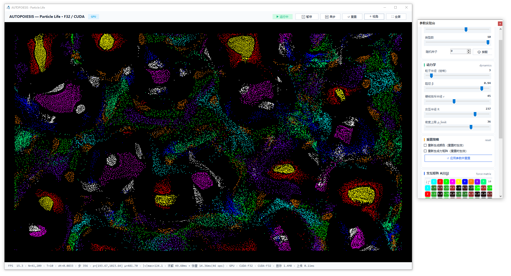

# Autopoiesis
A simple physics program made with Godot that shows the emergent properties of particle attraction.

> A VB.NET winform rewrite for https://github.com/OfficialCodeNoodles/Particle-Life-Simulation

